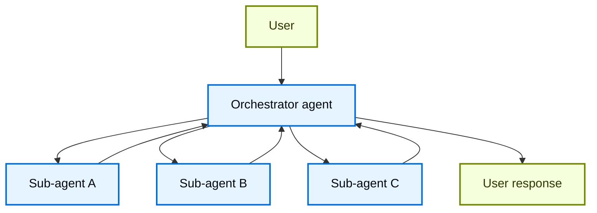
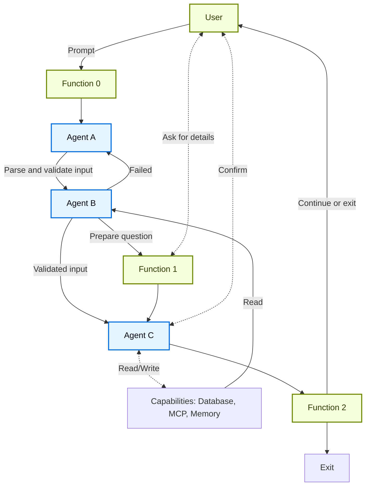
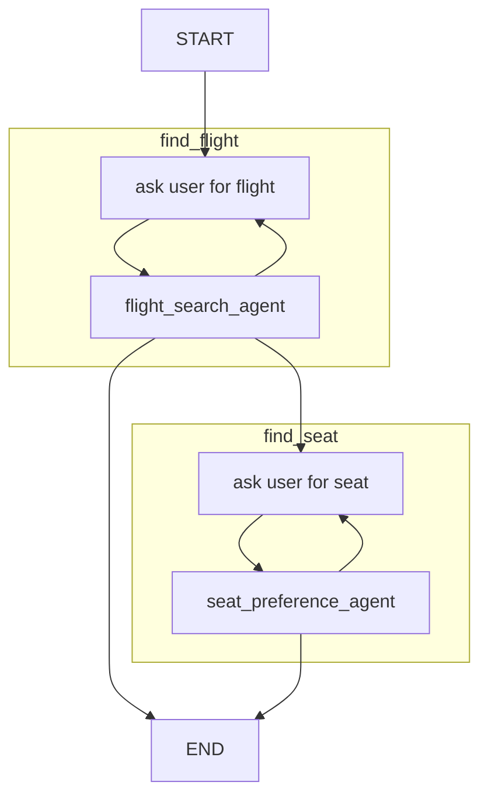

# 6. Multiple agents

:::{questions}

- What are multi-agent workflows?
- When does it make sense to use multi-agent workflows and when does it not?
- How do we connect multiple agents together, and are there different design patterns for doing so?
:::

:::{objectives}

- Understand how to design a multi-agent workflow.
- Analyze the pros and cons for using them.
:::

## Why multi-agent workflows

So far we have understood and played with single agent workflows. Often a single agent,
with:

- a broad role,
- several capabilities
- unstructured outputs
- data validation only within tools, and none before and after the agent responds.

When the number of capabilities grows (various tools, skills, MCP servers,
Memory etc.) in a single agent, the potential permutations
in which these will execute increases exponentially. This can make it difficult
to reason about the trajectory of the agent's execution and the quality of the
output. By breaking down the agent into multiple agents, each with a limited set
of tools and capabilities, we can reduce the complexity of the agent's execution
and improve the quality of the output.

Also, with multi-agents, each with a specific role -- allows to generate structured
output, with output validators. In other words, we could perform type validation and
logic validation, thereby catching some set of known failures early.

### Potential benefits of multi-agent workflows

- Per-agent model selection: different models for different tasks, since some
  tasks might be simple.
- Separation of concerns: limited set of tools per agent, similar to
  encapsulation in Object-oriented programming.
- Saving context size: ability to (somewhat) stateless, and separate message history
  per agent.
- Adding output type validation and data validators after each agent.
- Ability for the developer to split tasks into logical chunks and assign role.

The exact benefits can also vary depending on the architecture or design pattern
one chooses to adopt.

### Uncertainities of multi-agent workflows

Depending on the constuction of the multi-agent workflow, there are some
uncertainties with the following:

- Cost: can result in fewer or more model calls, more handoffs, more places to fail.
- Better, similar or worse complexity when it comes to possible trajectories of
  tool-calls compared to single-agent workflows.

## Design patterns of multi-agent workflows

Since this is an emerging field the names and understanding of these "patterns"
vary. In 2026, according to both
[LangChain](https://docs.langchain.com/oss/python/langchain/multi-agent/index#patterns)
and [Pydantic](https://pydantic.dev/docs/ai/guides/multi-agent-applications/),
these 4 patterns are mentioned:

1. Agent delegation — agents using another agent via tools, either wired up by
   hand or with the Harness’s `SubAgents` capability
1. Programmatic agent hand-off — one agent 3.runs, then application code calls
   another agent
1. Graph based control flow — for the most complex cases, a graph-based state
   machine can be used to control the execution of multiple agents
1. Deep Agents — autonomous agents with planning, file operations, task
   delegation, and sandboxed code execution

And before we get too excited, we also find this [gem of an advice](https://pydantic.dev/docs/ai/graph/graph/):

> If Pydantic AI agents are a hammer, and multi-agent workflows are a
  sledgehammer, then graphs are a nail gun... graphs are a powerful tool, but
  they’re not the right tool for every job. Please consider other multi-agent
  approaches before proceeding.

And therefore we will limit our attention to two patterns, namely **agent delegation**
and **programmatic agent hand-off**.

### Agent delegation a.k.a Subagents



Agent delegation is a design pattern where one "orchestrator" agent delegates a
task to child agents or "sub-agents". The sub-agent runs with its own message
history, so task must be self-contained.

### Programmatic hand-off

Programmatic hand-off is a design pattern where the output of one agent is used
as the input to another agent. With the handoffs pattern, when you need to
enforce sequential constraints (unlock capabilities only after preconditions are
met), and allows interaction with the user at specific points of the workflow.

Here is a typical hand-off multi-agent workflow.



Notice that in this pattern, the hand-off can occur from agent to agent, or from
agent to function and back to another agent. This allows the developer to
implement the workflow in a way that is most natural for the problem domain and
to add deterministic steps where needed.

## Breaking down the problem into different agents

TODO: show from flight_booking/agents.py

## Wiring the agents together

### Using agent-delegation

In Pydantic AI an "orchestrator" agent is a regular agent with a `SubAgent`
capability gets exposed a single `delegate_task(agent_name, task)` tool.

TODO: describe the parts

TODO: task control


### Exercise 6.1: Adding output validator to the hand-off workflow

::::{exercise}

Run `uv run 06_multi_agent_flight_booking.py`.

1. Try to prompt as follows, and notice how long it takes. In what step did the
   multi-agent workflow realize that this is invalid?

```text
Flight from Singapore to Helsinki
```

2. Exit the workflow.

3. Add a tool and output validator to the first agent inside `main_handoff.py`,
   allowing the model to recover from a wrong input, early!

```python
@trip_extractor_agent.tool_plain
def ask_user_for_clarification(question: str) -> str:
    """Ask the user a question and return their answer."""
    return input(f'🤖 {question}\nYou: ')

@trip_extractor_agent.output_validator
async def validate_trip_request(ctx: RunContext[Deps], output: TripRequest) -> TripRequest:
    """Validate origin and destination of the trip."""
    VALID_CITIES = {'Amsterdam', 'Barcelona', 'Copenhagen', 'Dublin', 'Frankfurt', 'Helsinki', 'Istanbul', 'Lisbon', 'London', 'Madrid', 'Munich', 'Oslo', 'Paris', 'Rome', 'Stockholm', 'Vienna', 'Warsaw', 'Zurich' }

    if (
        output.req_origin not in VALID_CITIES
        or output.req_destination not in VALID_CITIES
    ):
        raise ModelRetry(
            f'Invalid origin or destination city. Valid cities are: {VALID_CITIES}'
        )

    return output

```

:::{tip}
You can inject the above code in `main_handoff.py` at the highlighted section

```{literalinclude} ./hands-on/flight_booking/main_handoff.py
:language: python
:start-at: TODO: Add trip request tool and output validator
:end-at: Start agent loop
:emphasize-lines: 1-2
```
:::

4. Re-prompt the workflow, starting with an incorrect origin and/or destination.
::::


### Using hand-off




### Exercise 6.2: Discuss the differences

::::{discussion}
1. Which multi-agent pattern was more flexible and less sticter to use?
2. Which multi-agent pattern had a more predictable behaviour?

:::{solution}
- The agent-delegation pattern is more flexible and less strict to use.
- The programmatic hand-off pattern has a more predictable behaviour.
:::

::::


## Tracing and visualizing agent trajectories

Describe tracing with Jaeger.


### Exercise 6.4


:::{keypoints}
- ..
- ..
:::
