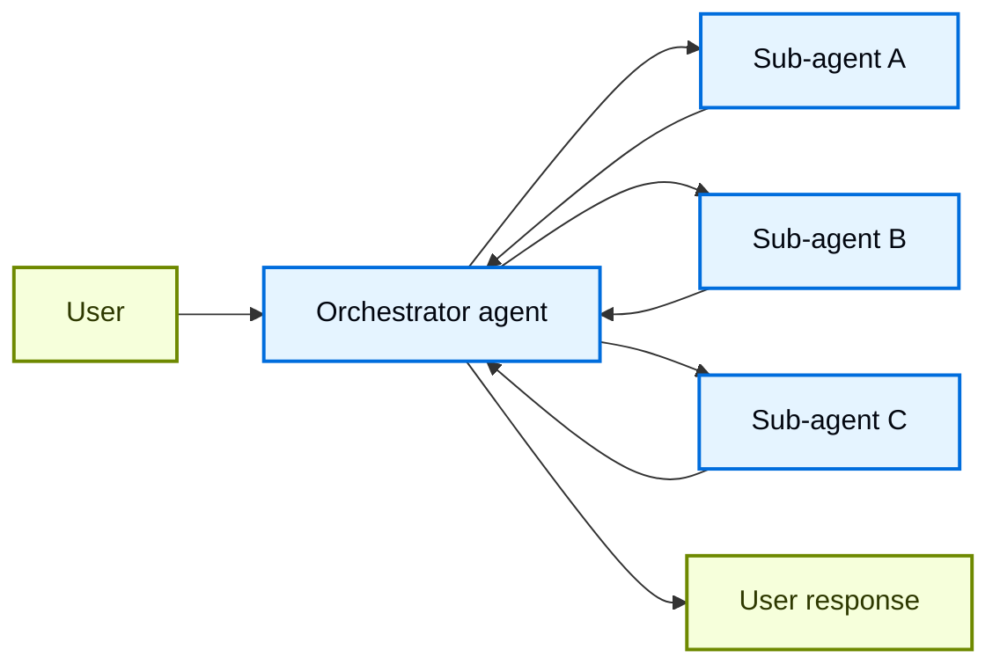
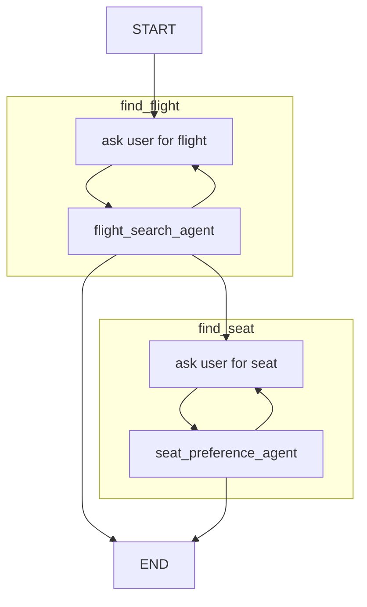

# 6. Multiple agents

:::{questions}

- What are multi-agent workflows?
- When does it make sense to use multi-agent workflows and when does it not?
- How do we connect multiple agents together, and are there different design patterns for doing so?
:::

:::{objectives}

- Understand how to design a multi-agent workflow.
- Analyze the pros and cons for using them.
:::

## Why multi-agent workflows

So far we have understood and played with single agent workflows. Often a single agent, with a precise role and a finite set of capabilities.

When the number of capabilities grows (various tools, skills, MCP servers,
Memory etc.) in a single agent increases in number, the potential permutations
in which these will execute increases exponentially. This can make it difficult
to reason about the trajectory of the agent's execution and the quality of the
output. By breaking down the agent into multiple agents, each with a limited set
of tools and capabilities, we can reduce the complexity of the agent's execution
and improve the quality of the output.

### Potential benefits of multi-agent workflows

- Per-agent model selection: different models for different tasks, since some
  tasks might be simple.
- Separation of concerns: limited set of tools per agent, similar to
  encapsulation in Object-oriented programming.
- Saving context size: ability to (somewhat) stateless, and separate message history
  per agent.
- Adding output type validation and data validators after each agent.
- Ability for the developer to split tasks into logical chunks and assign role.

The exact benefits can also vary depending on the architecture or design pattern
one chooses to adopt.

### Uncertainities of multi-agent workflows

Depending on the constuction of the multi-agent workflow, there are some
uncertainties with the following:

- Cost: can result in fewer or more model calls, more handoffs, more places to fail.
- Better, similar or worse complexity when it comes to possible trajectories of
  tool-calls compared to single-agent workflows.

## Design patterns of multi-agent workflows

Since this is an emerging field the names and understanding of these "patterns"
vary. In 2026, according to both
[LangChain](https://docs.langchain.com/oss/python/langchain/multi-agent/index#patterns)
and [Pydantic](https://pydantic.dev/docs/ai/guides/multi-agent-applications/),
these 4 patterns are mentioned:

1. Agent delegation — agents using another agent via tools, either wired up by
   hand or with the Harness’s `SubAgents` capability
1. Programmatic agent hand-off — one agent runs, then application code calls
   another agent
1. Graph based control flow — for the most complex cases, a graph-based state
   machine can be used to control the execution of multiple agents
1. Deep Agents — autonomous agents with planning, file operations, task
   delegation, and sandboxed code execution

And before we get too excited, we also find this [gem of an advice](https://pydantic.dev/docs/ai/graph/graph/):

> If Pydantic AI agents are a hammer, and multi-agent workflows are a sledgehammer, then graphs are a nail gun... graphs are a powerful tool, but they’re not the right tool for every job. Please consider other multi-agent approaches before proceeding.

And therefore we will limit our attention to two patterns, namely

### Agent delegation a.k.a Subagents

Agent delegation is a design pattern where one "orchestrator" agent delegates a
task to child agents or "sub-agents". In Pydantic AI this means that the
"orchestrator" agent via a `SubAgent` capability gets exposed a single
`delegate_task(agent_name, task)` tool.

The sub-agent runs with its own message history, so task must be self-contained.

### Programmatic hand-off

Programmatic hand-off is a design pattern where the output of one agent is used as the input to another agent. This is agent's behavior and the quality of the output.

## Tracing and visualizing agent trajectories

Describe tracing with Jaeger.
