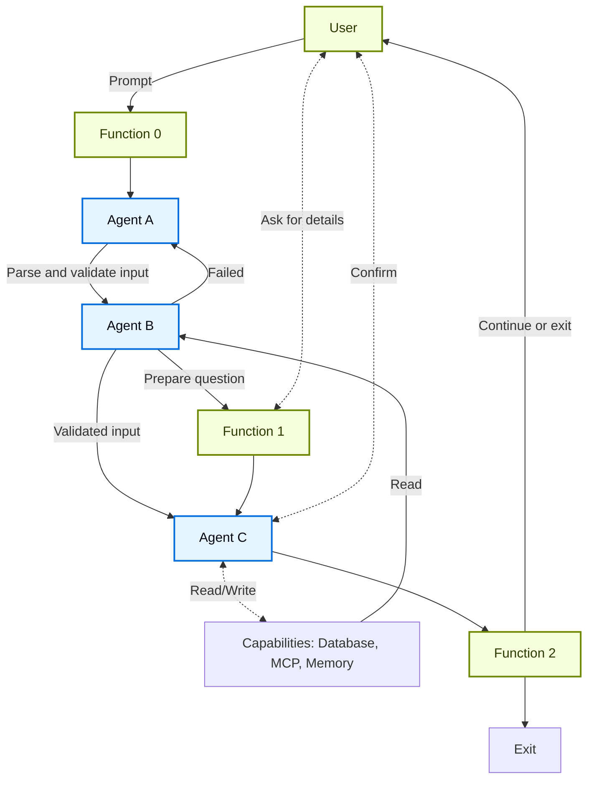
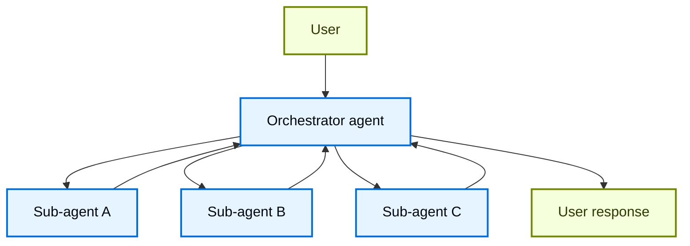
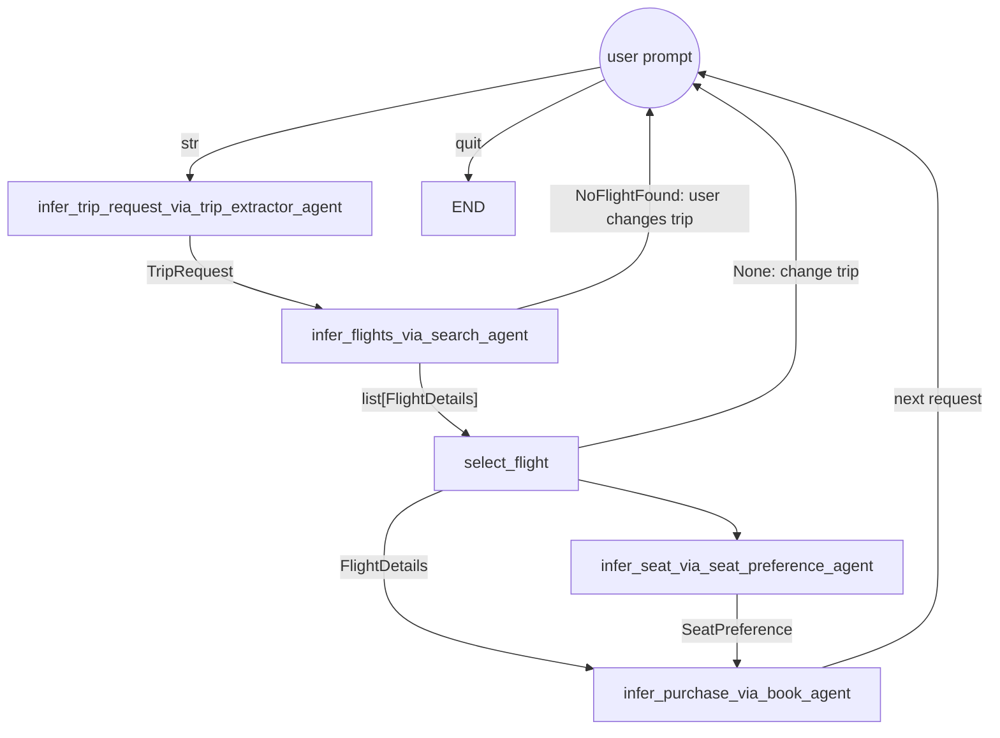
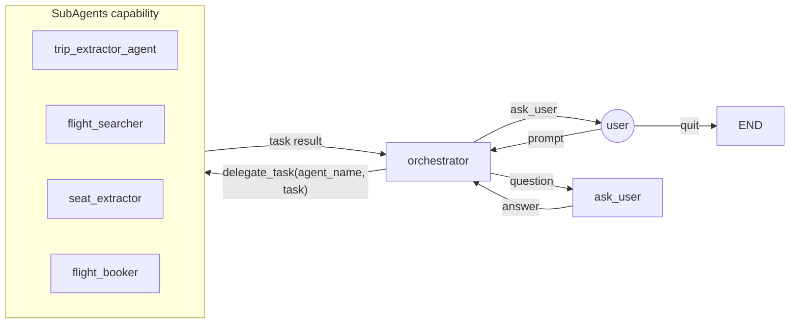

# 6. Multiple agents

:::{questions}

- What are multi-agent workflows?
- When does it make sense to use multi-agent workflows and when does it not?
- How do we connect multiple agents together, and are there different design patterns for doing so?
:::

:::{objectives}

- Understand how to design a multi-agent workflow.
- Analyze the pros and cons for using them.
:::

## Why multi-agent workflows

So far we have understood and played with single agent workflows. Often a single agent,
with:

- a broad role,
- several capabilities
- unstructured outputs
- data validation only within tools, and none before and after the agent responds.

When the number of capabilities grows (various tools, skills, MCP servers,
Memory etc.) in a single agent, the potential permutations
in which these will execute increases exponentially. This can make it difficult
to reason about the trajectory of the agent's execution and the quality of the
output. By breaking down the agent into multiple agents, each with a limited set
of tools and capabilities, we can reduce the complexity of the agent's execution
and improve the quality of the output.

Also, with multi-agents, each with a specific role -- allows to generate structured
output, with output validators. In other words, we could perform type validation and
logic validation, thereby catching some set of known failures early.

There are more benefits and drawbacks when it comes to multi-agent workflows.
It will become evident as we explore them. However here is a teaser:

:::{admonition} Potential benefits of multi-agent workflows
:class: note

- Per-agent model selection: different models for different tasks, since some
  tasks might be simple.
- Separation of concerns: limited set of tools per agent, similar to
  encapsulation in Object-oriented programming.
- Saving context size: ability to (somewhat) stateless, and separate message history
  per agent.
- Adding output type validation and data validators after each agent.
- Ability for the developer to split tasks into logical chunks and assign role.

The exact benefits can also vary depending on the architecture or design pattern
one chooses to adopt.

:::

:::{admonition} Uncertainities of multi-agent workflows
:class: warning

Depending on the constuction of the multi-agent workflow, there are some
uncertainties with the following:

- Cost: can result in fewer or more model calls, more handoffs, more places to fail.
- Better, similar or worse complexity when it comes to possible trajectories of
  tool-calls compared to single-agent workflows.

:::

## Design patterns of multi-agent workflows

Since this is an emerging field the names and understanding of these "patterns"
vary. In 2026, according to both
[LangChain](https://docs.langchain.com/oss/python/langchain/multi-agent/index#patterns)
and [Pydantic AI](https://pydantic.dev/docs/ai/guides/multi-agent-applications/),
these 4 patterns are mentioned:

1. Agent delegation — agents using another agent via tools, either wired up by
   hand or with the Harness’s `SubAgents` capability
1. Programmatic agent hand-off — one agent runs, then application code calls
   another agent (or a deterministic function) and so on
1. Graph based control flow — for the most complex cases, a graph-based state
   machine can be used to control the execution of multiple agents
1. Deep Agents — autonomous agents with planning, file operations, task
   delegation, and sandboxed code execution

And before we get too excited, we also find this [gem of an advice](https://pydantic.dev/docs/ai/graph/graph/):

> If Pydantic AI **agents** are a hammer, and **multi-agent workflows** are a
  sledgehammer, then **graphs** are a nail gun... graphs are a powerful tool, but
  they’re not the right tool for every job. Please consider other multi-agent
  approaches before proceeding.

And therefore we will limit our attention to two patterns, namely **agent delegation**
and **programmatic agent hand-off**.

### Programmatic agent hand-off

Programmatic hand-off is a design pattern where the output of one agent is used
as the input to another agent. With the handoffs pattern, when you need to
enforce sequential constraints (unlock capabilities only after preconditions are
met), and allows interaction with the user at specific points of the workflow.

Here is a typical hand-off multi-agent workflow.



Notice that in this pattern, the hand-off can occur from agent to agent, or from
agent to function and back to another agent. This allows the developer to
implement the workflow in a way that is most natural for the problem domain and
to add deterministic steps where needed.

### Agent delegation a.k.a Subagents



Agent delegation is a design pattern where one "orchestrator" agent delegates a
task to child agents or "sub-agents". The sub-agent runs with its own message
history, so task must be self-contained.

## Breaking down the problem into different agents

The flight booking problem naturally splits into four steps: understand where
and when the user wants to fly, search for flights, pick a seat, and book.
Each step has a clear input and output, which makes it a good fit for the
programmatic hand-off pattern. In `flight_booking/agents.py` each step becomes
one agent with a narrow role, its own output type, and its own validation --
together they play the role of agents A, B and C in the diagram above.

The data models define the "contract" between the agents:

```{literalinclude} ./hands-on/flight_booking/agents.py
:start-after: Data models for the agents
:end-before: extracting trip request from user
:emphasize-lines: 10-15, 31-32
```

`Deps` carries the requested origin and destination to tools and validators via
the context object `ctx.deps`. This is a _dependency injection_ mechanism is used
by Pydantic AI to transfer states.

`TripRequest`, `FlightDetails` and `SeatPreference` are the
structured outputs of the first three agents. Note how the models themselves
already encode data types and instructions: the `req_date` field description
tells the model to keep the date exactly as the user phrased it, and
`SeatPreference` restricts rows to 1-30 and seats to a valid letter, so
nonsense values fail validation before they can reach the next agent.

Finally, `SeatPreferenceFailed` is an empty marker data model:
and "could not extract a seat" is a possible outcome, so downstream
code can branch on the output type as an alternative to parsing errors.

### The trip extractor agent

```{literalinclude} ./hands-on/flight_booking/agents.py
:start-after: extracting trip request from user
:end-before: @trip_extractor_agent.output_validator
:emphasize-lines: 4, 12, 15
```

The first agent has a single job: turn the user's free-text prompt into a
`TripRequest`, sometimes with small corrections if needed. For example, it
transforms a prompt:

```text
Find me a flight from stockhom to helsinki next week
```

into

```py
TripRequest(req_origin='Stockholm', req_destination='Helsinki', req_date='next week')
```

It has no tools at all (for now) -- anything it cannot extract from the prompt
is a job for a later agent. The `retries=3` setting gives the model three
attempts to produce output that passes validation.

### The search agent

```{literalinclude} ./hands-on/flight_booking/agents.py
:start-after: The search agent finds flights
:end-before: extracting the user's seat selection
:emphasize-lines: 5, 8, 19, 41
```

The search agent resolves the relative date ("tomorrow", "next Friday") to a
concrete date using the `get_current_datetime` tool, then calls
`search_flights` and returns all matches sorted by price. Both tools come
from the MCP server we built in episode 4, attached here as a single
capability. The output type is a union: `list[FlightDetails] | NoFlightFound`
-- an empty search result is a valid answer, not an error.

The output validator performs procedural validation: every returned flight must
match the origin and destination in `ctx.deps`, and any mismatch raises a
`ModelRetry`, which sends the errors back to the model so it can correct itself
within its `retries` budget.

(the-seat-preference-agent)=
### The seat preference agent

```{literalinclude} ./hands-on/flight_booking/agents.py
:start-after: extracting the user's seat selection
:end-before: The book agent books the selected flight
:emphasize-lines: 3
```

The simplest of the four: no tools, no deps, no validator -- just a mapping
from the user's words onto the constrained `SeatPreference` model. The domain
knowledge (which seats are window or aisle, which rows have extra legroom)
lives in the instructions, so the model can for example infer a specific seat
when the user asks for "a window seat with extra legroom". If it cannot
extract a selection, it returns `Failed` rather than guessing.

### The book agent

```{literalinclude} ./hands-on/flight_booking/agents.py
:start-after: The book agent books the selected flight
:emphasize-lines: 6, 9, 12, 14
```

The final agent performs the side-effectful step: booking the flight. It
receives the chosen flight and seat as a tuple via `deps`, and its
instructions tell it to not ask the user for further input. This is where the
capabilities of the previous episodes come together in a single agent: the
MCP server provides the `book_flight` tool, the `travel-policy` skill checks
that the booking complies with the travel policy before the agent commits.

`Memory` persists data such as passenger name from `MEMORY.md`, injecting them
into every request.

## Wiring the agents together

### Using hand-off

The agents to use the programmatically hand-off pattern, are composed together in
a single `main` function in `flight_booking/hand_off.py`. The function is
structured as a loop that starts with the user prompt, and ends when the user
types `quit`. The loop is structured as a sequence of agents that are called
in turn, and each agent can either return a value to the next agent, or raise
an exception to signal that the user needs to change their trip request.



The above flowchart is implemented as follows, where all the `infer_*` functions
are helper functions that call the respective agents.

```{literalinclude} ./hands-on/flight_booking/main_handoff.py
:language: python
:start-at: async def main
:end-before: if __name__
:emphasize-lines: 15, 18, 33, 35-36
```

:::{danger}

Until now, we have been relying of `google/gemma-4-31b-it` as the
default model. Now we will have to change the `MODEL_NAME` in `.env` file, since
it has a tendency to get "perplexed" at the `search_agent` run. At least for the
"hand-off" example, you will be able to complete with one of the following
models:

```text
MODEL_NAME=Qwen/Qwen3.6-27B
MODEL_NAME=Qwen/Qwen3.8-27B
```

Some capabilities like memory and skill, unfortunately does not work with
Qwen3.x-27B models, so they have been disabled in the `book_agent` instance.

Potentially the following models may work too, but are untested at the moment.

```text
MODEL_NAME=google/gemma-4-26B-A4B-it
MODEL_NAME=openai/gpt-oss-120b
MODEL_NAME=Qwen/Qwen3-Coder-Next
```

Another model works with full capabilities is `zai-org/GLM-5.3-Flash`, and we will
demo it via another provider.

:::


(hand-off-demo)=

::::{demo}

- Run `uv run 06_multi_agent_flight_booking.py` and try one of the following prompts.

```text
Book me a flight from Frankfurt to Helsinki
```

```text
Flight to Amsterdam from Warsaw on Friday
```

:::{warning}

You can also try something ambiguous like this, but it can fail particularly with
"smaller" language models without instructions on how to translate country name to
probable cities.

```text
I want to fly from Stockholm to Netherlands in 3 months
```
:::


- Pick a flight
- For seat preference answer in one of the following:

```text
7A
```

```text
22, aisle seat
```

:::{warning}

Another ambiguous prompt for seat selection

```text
window seat with extra leg room
```
:::

::::

#### Exercise 6.1: Adding output validator to the hand-off workflow

::::{exercise}

Run `uv run 06_multi_agent_flight_booking.py`.

1. Try to prompt as follows, and notice how long it takes. In what step did the
   multi-agent workflow realize that this is invalid?

```text
Flight from Singapore to Helsinki
```

2. Exit the workflow.

3. Add a tool and output validator to the first agent inside `main_handoff.py`,
   allowing the model to recover from a wrong input, early!

```python
@trip_extractor_agent.tool_plain
def ask_user_for_clarification(question: str) -> str:
    """Ask the user a question and return their answer."""
    return input(f'🤖 {question}\nYou: ')

@trip_extractor_agent.output_validator
async def validate_trip_request(ctx: RunContext[Deps], output: TripRequest) -> TripRequest:
    """Validate origin and destination of the trip."""
    VALID_CITIES = {'Amsterdam', 'Barcelona', 'Copenhagen', 'Dublin', 'Frankfurt', 'Helsinki', 'Istanbul', 'Lisbon', 'London', 'Madrid', 'Munich', 'Oslo', 'Paris', 'Rome', 'Stockholm', 'Vienna', 'Warsaw', 'Zurich' }

    if (
        output.req_origin not in VALID_CITIES
        or output.req_destination not in VALID_CITIES
    ):
        raise ModelRetry(
            f'Invalid origin or destination city. Valid cities are: {VALID_CITIES}'
        )

    return output

```

:::{tip}
You can inject the above code in `flight_booking/main_handoff.py` at the highlighted section

```{literalinclude} ./hands-on/flight_booking/main_handoff.py
:language: python
:start-at: TODO: Add trip request tool and output validator
:end-at: Start agent loop
:emphasize-lines: 1-2
```

:::

4. Re-prompt the workflow, starting with an incorrect origin and/or destination.
::::

#### Exercise 6.2: Using a different model for seat preference

::::{exercise}

Seat preference being the simplest of the agents, can be set to a smaller model.

- Replace the default `model` used for the [seat preference
  agent](#the-seat-preference-agent) with a different one in
  `flight_booking/agents.py`

```{literalinclude} ./hands-on/flight_booking/agents.py
:start-after: extracting the user's seat selection
:end-before: The book agent books the selected flight
:emphasize-lines: 2
```

- Preferably use a smaller model, but anything running / available will do too. Run

  ```sh
  uv run 00_check_inference_server.py
  ```

  to find out what is running.

:::{tip}

In order to do so, copy the lines to define `model` and make a new `model_small`, in `flight_booking/config.py` with a different model name.

```{literalinclude} ./hands-on/flight_booking/config.py
:start-at: default model
:end-at: model_small
:emphasize-lines: 8-9
```

Import `model_small` into `flight_booking/agents.py` module and use it

:::

- Quickly test the change with one of the test prompts:

```sh
uv run 06_multi_agent_flight_booking.py --test
```

::::

### Using agent-delegation

In Pydantic AI an "orchestrator" agent is a regular agent whose `SubAgents`
capability exposes the specialist agents to it as a single
`delegate_task(agent_name, task)` tool. Where the hand-off pattern hardcodes
the pipeline in `main`, here the orchestrator's instructions describe the
booking workflow, and the model decides for itself which sub-agent to call at
each step.



The four specialists from `agents.py` are registered under a name and a
description. The description is all the orchestrator sees when routing, so it
doubles as the routing prompt. The `ask_user` tool lets the orchestrator talk
to the user mid-run, for example to present the found flights or ask for a
seat.

```{literalinclude} ./hands-on/flight_booking/main_delegation.py
:language: python
:start-at: orchestrator = Agent
:end-before: async def main
:emphasize-lines: 7, 15, 24, 32, 43, 67
```

Each delegation runs the sub-agent with its own message history, so a task
must be self-contained -- this is why the instructions tell the orchestrator
to spell out every field of the chosen flight and seat when delegating the
purchase.

With the routing moved into the agent, `main` shrinks to a single
`orchestrator.run` call per turn; the conversation history and the shared
usage limits are all the state the loop keeps, with the history only visible
to the orchestrator agent.

```{literalinclude} ./hands-on/flight_booking/main_delegation.py
:language: python
:start-at: async def main
:end-before: if __name__
:emphasize-lines: 15
```

::::{demo}
Run

```sh
uv run 06_multi_agent_flight_booking.py --pattern delegation
```

Try one of the prompt as in the [hand-off demo](#hand-off-demo), and watch the
orchestrator present the flights and ask for your seat before delegating the
purchase.

::::

## Tracing and visualizing agent trajectories

Hitherto, we have been staring at a lot of logs. It becomes complex to
understand what happened when, particularly when multiple agents are involved.
This is were collecting **traces** in graphical tool becomes useful.

Think of a trace as a diary of everything your program did in one run. Every
model call, tool invocation, and agent hand-off is recorded as a *span*: what
went in, what came out, and how long it took. One agent run produces a tree
of these spans -- the *trace*. So when your agent, say books seat 7A on the wrong
flight, you do not have to guess why: the trace shows the whole journey, which
agents ran, what they asked the model, and what the tools answered.

Each `logfire.span` block becomes one span in the trace, and each `logfire.info`
call records a log event with structured, searchable attributes. We have been
writing trace data all along: every hand-off in the multi-agent pipeline is
wrapped in a named span

```{literalinclude} ./hands-on/flight_booking/main_handoff.py
:language: python
:start-at: with logfire.span('Search Agent
:end-at: return result.output
:emphasize-lines: 1
```

and the trip-extractor agent logs the extracted trip request as an event with
named attributes

```{literalinclude} ./hands-on/flight_booking/agents.py
:language: python
:start-at: @trip_extractor_agent.output_validator
:end-at: return output
:emphasize-lines: 4-9
```

So how do Logfire, OpenTelemetry and Jaeger play together? **OpenTelemetry**
is the open standard that defines what spans look like and how they travel
between systems (via the OTLP protocol). **Logfire** is what creates the
spans in our example: its SDK instruments Pydantic AI and httpx, and exports
the resulting traces either to Logfire's own backend or to any
OpenTelemetry-compatible endpoint. **Jaeger** is one such endpoint: an
open-source tracing backend with a web UI for browsing traces. Because
everything speaks OpenTelemetry, you can swap Jaeger for Logfire (the web frontend) or any of
the [vendors supporting OpenTelemetry](https://opentelemetry.io/ecosystem/vendors/)
without touching the instrumentation code. For LLM and agent spans, the
community is standardizing the attribute names (`gen_ai.*`) in the
[OpenTelemetry GenAI semantic conventions](https://github.com/open-telemetry/semantic-conventions-genai);
[MLflow's take on them](https://mlflow.org/docs/latest/genai/tracing/opentelemetry/genai-semconv/)
is a good overview of how a backend consumes these attributes.

Other popular tools for visualizing agent trajectories include:

- **MLflow**: the classic experiment tracker, with GenAI tracing that follows
  the OpenTelemetry semantic conventions linked above.
- **Langfuse**: open-source LLM engineering platform, with tracing, prompt
  management and evaluations; can ingest traces over OTLP.
- **Phoenix by Arize**: commercial observability and evaluation platform for
  LLM applications (its tracing library itself is open source).

::::{demo}

- In `flight_booking/config.py`, change the logging configuration from
  `log_default` to `log_jaeger`:

```python
config_logging.log_jaeger()
```

- In a **new terminal**, start Jaeger (if in Windows, look at the contents of the script to understand how to run it):

```sh
bash 06_run_jaeger.sh
```

- Run the multi-agent demo in test mode:

```sh
uv run 06_multi_agent_flight_booking.py --test
```

- Open the Jaeger UI at <http://localhost:16686>, select the `flight_booking`
  service and open the latest trace. Inspect the waterfall of spans: the
  orchestrator run, the model requests, the tool calls to the MCP server, and
  the hand-off to the booking agent. The *GenAI* tab shows the captured
  request and response bodies rendered as a conversation.

::::

### Exercise 6.3: Discuss the differences

::::{discussion}

1. Which multi-agent pattern was more flexible and less sticter to use?
2. Which multi-agent pattern had a more predictable behaviour?

:::{solution}

- The agent-delegation pattern is more flexible and less strict to use.
- The programmatic hand-off pattern has a more predictable behaviour.
:::

::::

## Summary

:::{keypoints}

- Multi-agent workflows split a complex task into agents with narrow roles, giving per-agent model selection, separation of concerns, smaller context per agent, and output validation after each step -- at the cost of more model calls and more places to fail.
- The two patterns covered are programmatic hand-off, where application code chains agents in a fixed sequence, and agent delegation, where an orchestrator agent routes tasks to sub-agents via a `delegate_task` tool.
- Hand-off is more predictable since the pipeline is hardcoded in `main`, while delegation is more flexible since the orchestrator decides which sub-agent to call,
:::

Here are some of the pages for your reference and further reading.

:::{seealso}
- [Multi-Agent Applications | Pydantic Docs](https://pydantic.dev/docs/ai/guides/multi-agent-applications/)
- [Why multi-agent - LangChain](https://docs.langchain.com/oss/python/langchain/multi-agent/index#why-multi-agent)
- [Subagents | Pydantic Docs](https://pydantic.dev/docs/ai/harness/subagents/)
- [Graphs | Pydantic Docs](https://pydantic.dev/docs/ai/graph/graph/)
- [Planning | Pydantic Docs](https://pydantic.dev/docs/ai/harness/planning/)
- [How we built our multi-agent research system \ Anthropic](https://www.anthropic.com/research/multi-agent-research-system)
- 
:::
